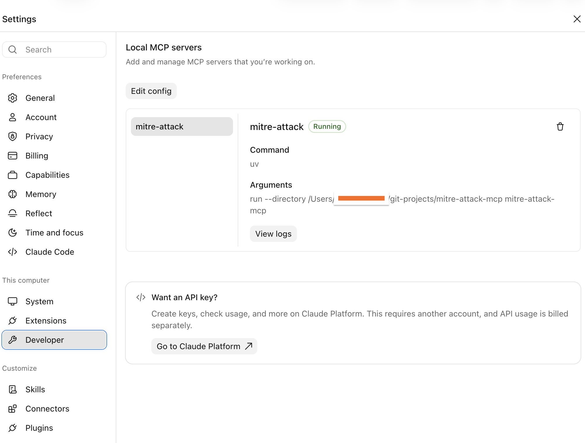
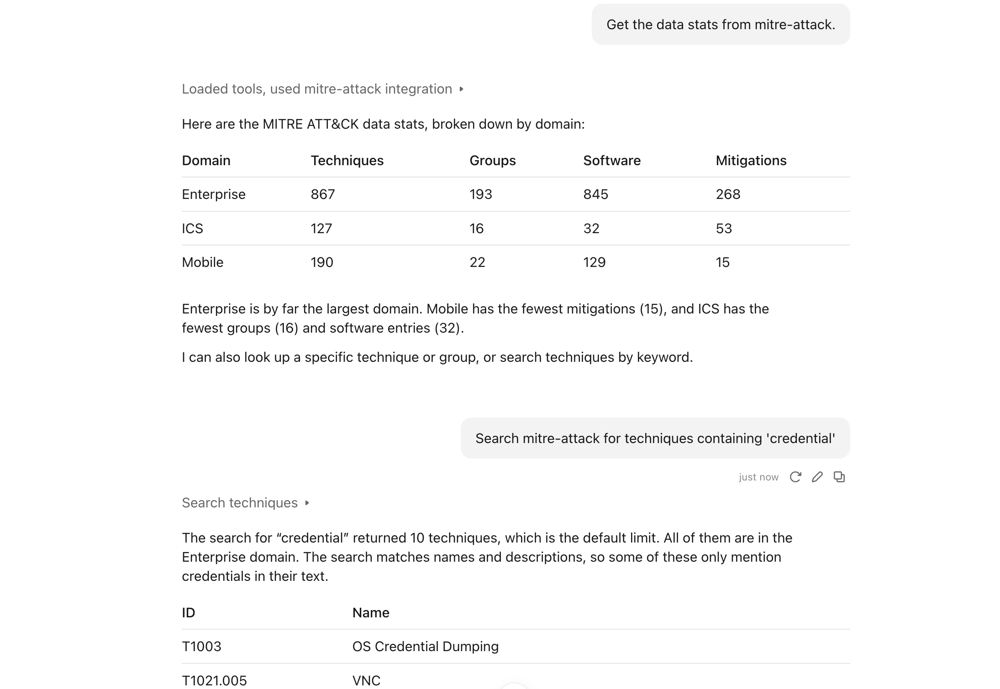

# mitre-attack-mcp
MITRE ATT&amp;CK MCP Server

# Description


# Project setup
- uv venv
- source .venv/bin/activate
- uv sync

# Data ingestion
- MITRE data auto downloaded while MCP server starts

# Run MCP server locally
- uv run python -m mitre_attack_mcp.server
#### Note: Dont run with Claude, its for local testing only

# Unit tests
- uv run pytest tests/ -v

# Integration with Anthropic claude CLI
```
1. Clone code repository locally

2. Check mcps: claude mcp list

3. Add below configs in macOS: ~/Library/Application Support/Claude/claude_desktop_config.json

  "mcpServers": {
    "mitre-attack": {
      "command": "uv",
      "args": [
        "run",
        "--directory",
        "/Users/john/git-projects/mitre-attack-mcp",
        "mitre-attack-mcp"
      ]
    }
  }


4. Register mitre mcp: claude mcp add --scope user mitre-attack -- uv run --directory /Users/john/git-projects/mitre-attack-mcp mitre-attack-mcp

5. Check mitre-attack mcp: claude mcp list

6. Check detail: claude mcp get mitre-attack

```
# Integration with Anthropic claude desktop
```
1. Claude desktop -> Settings -> Developer -> Edit config

2. Add below configs:

  "mcpServers": {
    "mitre-attack": {
      "command": "uv",
      "args": [
        "run",
        "--directory",
        "/Users/john/git-projects/mitre-attack-mcp",
        "mitre-attack-mcp"
      ]
    }
  }

3. Relaunch Claude

```



# Claude Desktop Assistant With Mitre MCP



# Common prompts
```
Search mitre-attack for techniques containing 'credential'.
Get the data stats from mitre-attack.
Look up the group APT29 in mitre-attack.
Use the mitre-attack server to look up technique T1059.
what is mitigations for T1003.
```